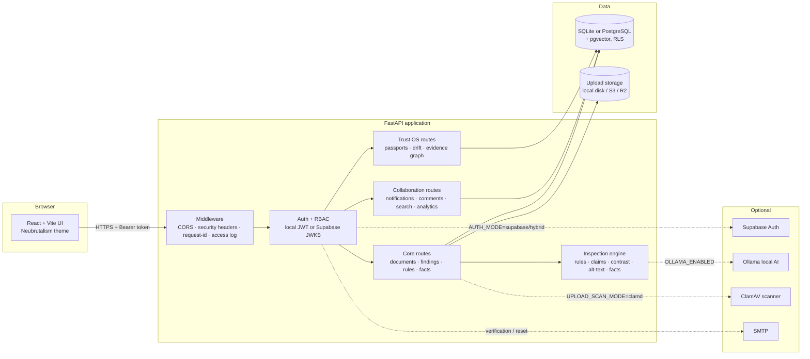
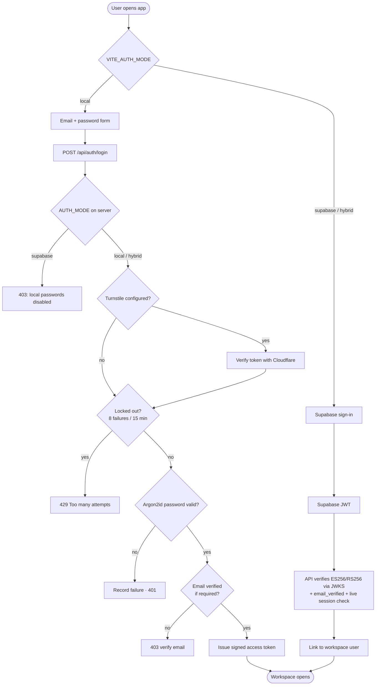
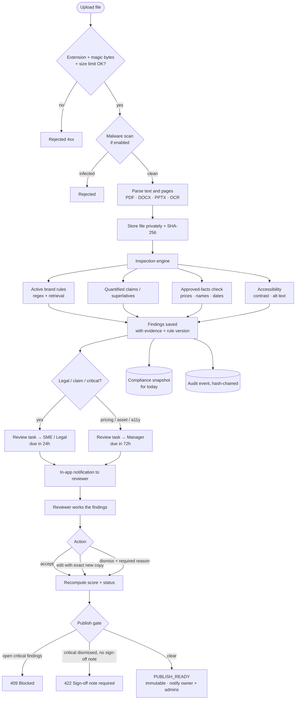
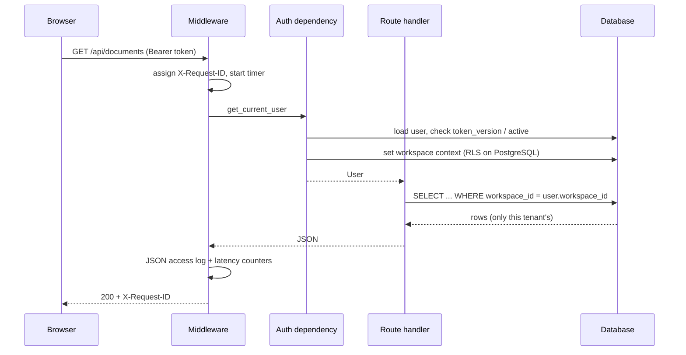
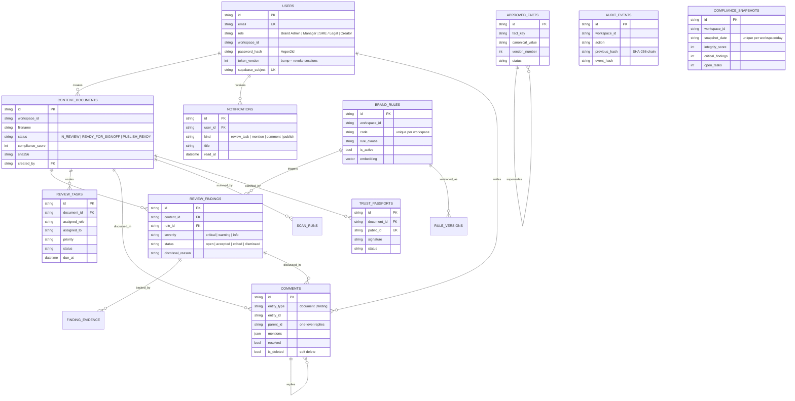

# ContexA Studio

**Pre-publication brand-governance and trust workspace.** Upload marketing content (PDF, DOCX, PPTX, text, images), have it checked against your brand rules and approved facts, route risky findings to the right reviewers, discuss them, and only mark content *Publish Ready* once the sign-off gate is satisfied — with a tamper-evident audit trail behind every step.

React + Vite frontend (two switchable interface styles) · FastAPI backend · SQLite (local) or PostgreSQL + pgvector (production) · local email/password auth or Supabase Auth.

---

## Contents

1. [Quick start](#quick-start)
2. [How it works (flowcharts)](#how-it-works)
3. [Database design](#database-design)
4. [Backend architecture](#backend-architecture)
5. [API reference](#api-reference)
6. [Configuration](#configuration)
7. [Operations: health, metrics, backups](#operations)
8. [Testing](#testing)
9. [Security model](#security-model)
10. [Honest limitations](#honest-limitations)

---

## Quick start

Requirements: Python 3.11+ (3.12 recommended), Node.js 20+, npm.

```bash
# macOS / Linux
./run-submission.sh          # offline demo profile: rules-only, no Ollama / cloud key / Supabase needed
# Windows
run-submission.bat
```

Then open **http://localhost:5173** (API docs: http://localhost:8000/docs).

| Role | Email | Password |
|---|---|---|
| Brand Admin | `admin@contexa.local` | `ContexA!2026` |
| Manager | `manager@contexa.local` | `Manager!2026` |
| SME / Legal | `legal@contexa.local` | `Legal!2026` |
| Creator | `creator@contexa.local` | `Creator!2026` |

These accounts are also **listed on the sign-in page itself** (click one to fill the form; the admin is pre-filled), so anyone can log in and test immediately. They exist, and the panel is shown, **only** when the server runs with `APP_ENV=development`, `demo` or `test`. In production the panel, the pre-fill and the demo-data loader are all hidden automatically (`GET /api/auth/config` tells the UI). After signing in as the admin, use **Prepare demo workspace** on the dashboard to load clearly-labelled sample documents.

> **"Local password authentication is disabled"?** Your `.env` has `AUTH_MODE=supabase`. Set `AUTH_MODE=local` (backend `.env`) and `VITE_AUTH_MODE=local` (`frontend/.env`). See [FIX_NOTES.md](FIX_NOTES.md).

Manual start:

```bash
python -m venv .venv && source .venv/bin/activate
pip install -r backend/requirements.txt
cp .env.example .env && cp frontend/.env.example frontend/.env
(cd frontend && npm install && npm run dev) &
python -m uvicorn app.main:app --app-dir backend --host 127.0.0.1 --port 8000 --reload
```

---

## How it works

### 1. System architecture



### 2. Sign-in flow



Forgot password (local mode): `POST /api/auth/password/forgot` → one-time hashed token → email link (or on-screen/log link in development when SMTP is not configured) → `POST /api/auth/password/reset`, which also invalidates every existing session (`token_version` bump).

### 3. Document review lifecycle



### 4. Typical request lifecycle



---

## Database design

SQLAlchemy models are the source of truth; `backend/app/migrations.py` applies additive, versioned, idempotent migrations (recorded in `schema_migrations`). Every tenant-owned table carries `workspace_id`, filtered in code **and** enforced by PostgreSQL forced row-level security.



Additional tables (not drawn): `guideline_chunks`, `scan_runs`, `evaluation_cases/runs`, `policy_simulations`, `brand_assets`, `monitored_sources`, `truth_drift_events`, `media_inspections`, `agent_runs`, `digital_twin_scenarios`, `language_reviews`, `regulatory_requirements/assessments`, `brand_incidents`, `evidence_graph_nodes/edges`, `decision_traces`, `evidence_archives`, `evidence_merkle_anchors`, `auth_action_tokens`, `login_attempts`, `public_passport_index`.

**Migrations**

| Version | What it does |
|---|---|
| `2026_11_01_01_trust_os_capabilities` | Trust OS tables |
| `2026_11_01_02_public_passport_index` | Public passport lookup index + backfill |
| `2026_11_01_03_enterprise_trust_foundation` | `users.supabase_subject` + unique index |
| `2026_11_01_04_collaboration_analytics_indexes` | `notifications`, `comments`, `compliance_snapshots`, seven composite hot-path indexes |

PostgreSQL DBAs can run the explicit SQL in `ops/round4_collaboration_postgres.sql` (also includes the RLS policies for the three new tables).

---

## Backend architecture

```
backend/app/
├── main.py            core routes, auth endpoints, review workflow, startup checks
├── collaboration.py   notifications, comments, search, analytics, health/metrics, request-id middleware
├── capabilities.py    Trust OS (passports, truth drift, agents, evidence graph, ...)
├── foundation.py      enterprise trust foundation (KMS signing, Merkle anchors, archives)
├── inspection.py      deterministic + optional local-AI inspection engine
├── parsing.py         PDF / DOCX / PPTX / text / OCR extraction
├── upload_security.py signature validation, size limits, optional ClamAV
├── security.py        Argon2id, tokens, Supabase JWKS verification, RBAC dependencies
├── models.py          SQLAlchemy models        database.py   engine, RLS policies
├── migrations.py      versioned additive migrations
└── config.py          every environment variable, parsed once
```

**Interface styles**

Switch at any time from the sign-in page or **Settings → Interface style**; the choice is remembered in the browser.

- **Professional (default)** — a document-first "ledger" look: warm paper, serif headings (Newsreader), Inter for the interface, monospace only for rule codes, hairline rules instead of floating cards, a dark sidebar, and one signal colour (vermilion) reserved for risk. The dashboard opens with a plain-language status sentence computed from your real data instead of decoration, and the review page shows the document as a page with every open finding's flagged passage highlighted in the text.
- **Neubrutalism** — the original loud style: thick outlines, hard shadows, flat saturated colour.

Both styles share the same components; each is a CSS layer scoped to `<html data-style="pro|neo">` (`frontend/src/professional.css`, `frontend/src/neubrutalism.css`), and your colourway applies to either. Fonts load from Google Fonts and fall back to Georgia / system fonts offline.

**What you see in the app**

- **Topbar bell** — a real inbox with an unread badge (polls every 45 s and on window focus); clicking an item opens the document and marks it read.
- **Review page → highlighted document** — open findings are marked directly in the extracted text (red = critical, amber = warning, blue = info); clicking a mark selects that finding.
- **Review page → Discussion / Activity** — threaded comments with `@email` mentions, resolve/reopen, delete, plus the document's audit timeline.
- **Dashboard → Compliance trend** — integrity score line and critical-finding bars from the daily snapshots, 7/30/90-day range, CSV download.
- **Sign-in page** — asks `GET /api/auth/config` and only shows what works: demo accounts (dev/demo/test only), *Create account* (only if sign-up is open) and *Forgot password?* (only if email is configured, or in development where the link is shown on screen).

**Collaboration & analytics (new)**

- **Notifications** are created by real events: review-task routing (to the assigned reviewer, or to Brand Admins when no reviewer holds that role), `@email` mentions, comments on your upload, and publication. Recipients are always active members of the same workspace and never the actor.
- **Comments** attach to a document or a finding, support one level of replies, `@email` mentions, resolve/unresolve (author or reviewer), edit (author only) and soft delete (author or Brand Admin). Every change is written to the audit chain.
- **Compliance snapshots** are upserted (one row per workspace per UTC day) after every upload, rescan, finding action, publication and deletion. The trend endpoint reports what the data actually was — history starts on the first day the workspace is used; nothing is back-filled or invented.
- **Search** is server-side across documents, rules, findings and comments, workspace-scoped, with `%`/`_` escaped so a wildcard cannot match everything.
- **Per-document activity** reads the hash-chained audit log for the document and its findings.

---

## API reference

Interactive docs at `/docs`. Grouped summary (all routes except health/public passports require `Authorization: Bearer <token>`):

| Area | Routes |
|---|---|
| **Auth** | `POST /api/auth/login` · `register` · `verify-email` · `password/forgot` · `password/reset` · `logout` · `GET /api/auth/me` |
| **Team** | `GET/POST /api/users` · `POST /api/users/{id}/deactivate` · `POST /api/invitations` · `POST /api/invitations/accept` |
| **Documents** | `GET /api/documents` · `POST /api/documents/upload` · `GET /api/documents/{id}` · `.../preview/{page}` · `POST .../rescan` · `POST .../publish` · `GET .../export` · `DELETE` |
| **Findings** | `POST /api/findings/{id}/action` · `GET /api/findings/{id}/evidence` |
| **Rules & facts** | `GET/POST /api/rules` · `PATCH /api/rules/{id}` · `GET .../versions` · `GET/POST /api/facts` · `.../approve` · `.../revise` · `POST /api/guidelines/import` |
| **Copy check** | `POST /api/check-copy` |
| **Review tasks** | `GET /api/review-tasks` · `PATCH /api/review-tasks/{id}` |
| **Notifications** | `GET /api/notifications` · `GET .../unread-count` · `POST .../{id}/read` · `POST .../read-all` |
| **Comments** | `GET /api/comments?entity_type=&entity_id=` · `POST /api/comments` · `PATCH/DELETE /api/comments/{id}` |
| **Activity & analytics** | `GET /api/documents/{id}/activity` · `GET /api/analytics/trend?days=&format=json\|csv` · `POST /api/analytics/snapshot` · `GET /api/analytics/workload` |
| **Search** | `GET /api/search?q=` |
| **Audit** | `GET /api/audit` · `GET /api/audit/verify` · `GET /api/workspace/export` · `DELETE /api/workspace` |
| **Evaluation** | `POST /api/evaluation/seed\|import\|run` · `GET /api/evaluation/runs` |
| **Trust OS** | `/api/trust-os/*` · `/api/trust-passports/*` · `/api/truth-drift/*` · `/api/public/trust-passports/{id}` |
| **Sign-in options** | `GET /api/auth/config` (public, non-sensitive) |
| **Ops** | `GET /api/health` · `/api/health/live` · `/api/health/ready` · `/api/metrics` (token) |

**Roles:** Creators upload and comment; Managers, SME / Legal and Brand Admins sign off and publish; only Brand Admins manage rules, team and the workspace. Critical legal/claim findings can only be actioned by reviewers.

---

## Configuration

Backend variables live in `.env`; browser variables (`VITE_*`) in `frontend/.env`. Full annotated list: `.env.example`.

| Variable | Default | Purpose |
|---|---|---|
| `APP_ENV` | `development` | `development`/`demo`/`test` seed demo users; `production` enforces strict startup checks |
| `AUTH_MODE` / `VITE_AUTH_MODE` | `local` | `local`, `hybrid` or `supabase` — **must match on both sides** |
| `DATABASE_URL` | SQLite file | `postgresql+psycopg://...` for production |
| `SECRET_KEY` | dev value | ≥32 random chars required in production |
| `ALLOWED_ORIGINS` | localhost:5173 | exact HTTPS origins in production |
| `OLLAMA_ENABLED` / `AI_VERIFICATION_ENABLED` | `false` | opt-in local AI review |
| `UPLOAD_SCAN_MODE` | `disabled` | `clamd` to scan uploads |
| `S3_*` | empty | S3 / R2 / MinIO private object storage |
| `SMTP_*`, `EMAIL_VERIFICATION_REQUIRED` | empty / `false` | real email for verification and reset |
| `METRICS_TOKEN` | empty | enables `/api/metrics` for Prometheus (header `X-Metrics-Token`) |

---

## Operations

- **Liveness / readiness:** `GET /api/health/live` (process up) and `GET /api/health/ready` (database reachable, migrations applied, upload storage writable → otherwise `503`).
- **Request tracing:** every response carries `X-Request-ID` (a valid client-supplied id is honoured). API requests are logged as one JSON line: id, method, path, status, milliseconds.
- **Metrics:** set `METRICS_TOKEN`, then scrape `/api/metrics` with `X-Metrics-Token`. Process-level counters only (requests by method/status class, latency sum/count, slow requests, uptime) — no tenant data.
- **Backups:**
  - SQLite: `python ops/backup_sqlite.py` — online-safe backup API, integrity check, SHA-256 file, keeps newest 14.
  - PostgreSQL: `ops/backup_postgres.sh` / `ops/restore_postgres.sh`.
- **Verification scripts:** `ops/verify_postgres_rls.py`, `ops/verify_supabase_project.py`, `ops/check_smtp.py`, `ops/check_object_storage.py`, `ops/check_clamd.py`.

---

## Testing

```bash
cd backend && python -m pytest -q        # 98 tests
cd frontend && npm run build              # type-check + production build
```

Covers: auth and lockout, upload validation, review gate and publish rules, audit-chain integrity, tenant isolation, Trust OS, migrations, and the new collaboration/analytics/health endpoints (including cross-tenant access attempts and wildcard-search escaping).

---

## Security model

- Passwords hashed with **Argon2id**; reset and verification tokens are hashed, single-use and expiring; password reset revokes all sessions.
- Login/signup/reset/upload **rate limits** with persisted counters; optional Cloudflare Turnstile.
- **Tenant isolation twice:** every query filters by `workspace_id`, and on PostgreSQL forced RLS policies cover every tenant table (verified by `verify_postgres_rls`).
- Uploads: extension + magic-byte validation, size caps, optional ClamAV, private storage.
- **Tamper-evident audit log:** each event stores the hash of the previous one; `/api/audit/verify` recomputes the chain.
- Security headers + CSP, strict CORS, production startup refuses weak secrets, SQLite, plaintext SMTP or missing RLS.

---

## Honest limitations

- This is a runnable MVP / deployment starter, **not a certified enterprise product**. Read [PRODUCT_READINESS.md](PRODUCT_READINESS.md) before processing real customer content.
- The new PostgreSQL SQL (`ops/round4_collaboration_postgres.sql`) and RLS entries mirror the tested SQLAlchemy models, but the automated tests run on SQLite; run `ops/verify_postgres_rls.py` against your PostgreSQL instance before relying on them.
- Demo credentials and the default secret are for local use only.
- Local embeddings are deterministic hashed-token vectors (reproducible, offline), not a semantic model.
- Logo clearspace, text-over-image contrast and "is this price current?" need visual review or an authoritative connected source; the app does not pretend to infer them from text.
- The seeded 50-case evaluation is a regression suite, not a blind benchmark.
- The UI was checked visually in headless Chromium at desktop width (1440 px) and with an automated contrast audit (0 low-contrast text items in both styles); tablet/phone layouts inherit the original responsive rules and were not re-reviewed.
- The example document on the Professional sign-in page is illustrative, and is labelled as such.

Older release notes are kept in [docs/README_LEGACY.md](docs/README_LEGACY.md) and the root `*.md` files.
